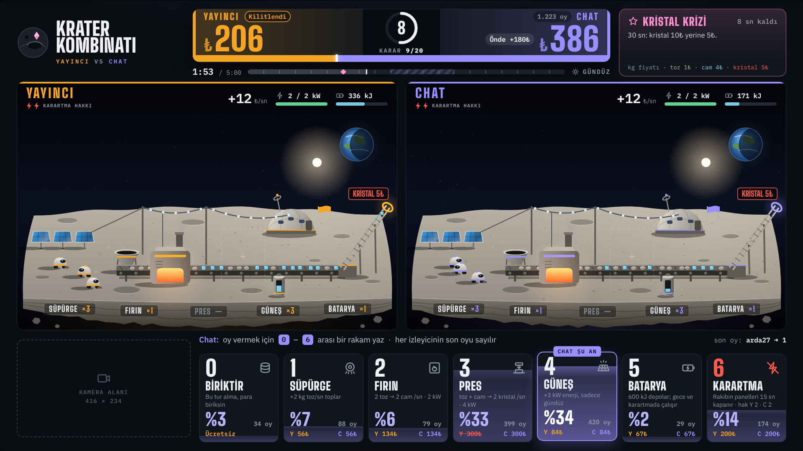
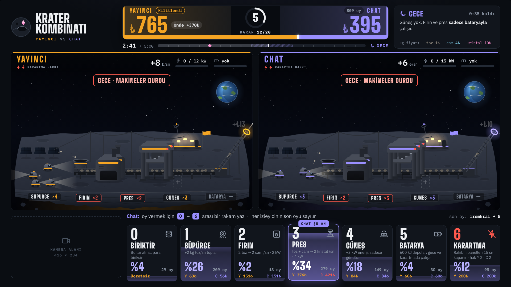
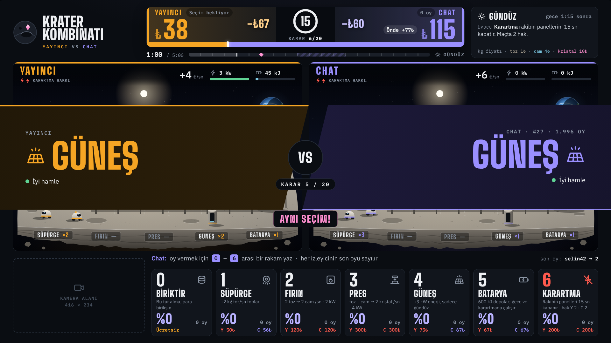
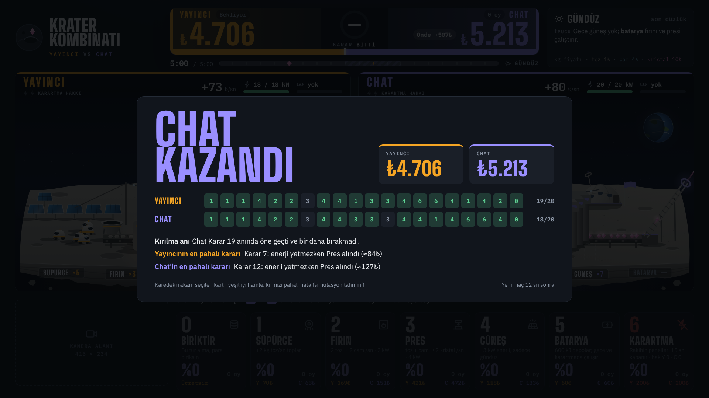

# Krater Kombinatı · Yayıncı vs Chat

Kick yayınları için tasarladığım tarayıcı oyunu: yayıncı ile chat aynı ay fabrikasını yan yana kurar, 5 dakikanın sonunda kasası dolu olan kazanır.

**[▶ Tarayıcıda oyna](https://berkaycongarr.github.io/krater-kombinati/)**



> **In English:** A browser game built for Kick live streams. The streamer and the chat build the same moon factory side by side and race for five minutes. Every 15 seconds the streamer picks a machine in secret while the chat votes by typing 0–6; both picks are revealed at the same moment. The simulation core (`js/sim.js`) is deterministic and runs in the browser and in Node.js. A rollout-based AI plays the bots, drives the simulated chat crowd and grades every decision in the end-of-match report. The broadcast scene is a fixed 1920×1080 stage, ready for OBS. Plain JavaScript and Canvas 2D, no framework. The UI is in Turkish.

## Nasıl oynanır

- Maç 5 dakika sürer ve her 15 saniyede bir karar verilir, toplam 20 karar.
- Yayıncı kartını gizlice seçer. Chat 0–6 arası bir rakam yazarak oy verir ve her izleyicinin son oyu sayılır. İki seçim tur sonunda aynı anda açılır.
- Üretim zinciri: süpürge toz toplar (1₺), fırın tozu cama çevirir (4₺), pres toz ve camdan kristal yapar (10₺).
- Fırın ve pres enerji ister. Güneş paneli yalnızca gündüz üretir, gece fabrikayı batarya döndürür.
- Aynı makine her alımda %12 pahalanır, son turlarda alınan makine kendini ödemeyebilir.
- Her maçta bir rastgele olay olur (meteor yağmuru, toz fırtınası, kristal krizi, güneş patlaması) ve bir tur önceden duyurulur.
- Karartma kartı rakibin güneş panellerini 15 saniye kapatır. Maçta 2 hak vardır.

Demoda iki tarafı da bot oynar, chat oyları da simüle edilir. Klavyede 0–6'ya basarak ya da bir karta dokunarak yayıncı tarafını devralabilirsin. Boşluk tuşu oyunu duraklatır.

## Ekranlar

| Gece | Açılış anı |
|:---:|:---:|
|  |  |
| **Maç sonu karnesi** | |
|  | |

## Nasıl çalışır

- **`js/sim.js` · simülasyon çekirdeği.** Ekonomi, enerji, gece, olaylar ve tohumlu rastgelelik burada. Tarayıcıda `window.KK`, Node'da `require()` ile kullanılır.
- **Yapay zekâ.** Her seçeneği maçın sonuna kadar simüle ederek değerlendirir: bu tur o makineyi al, sonraki tur en iyisini al, sonra kurala göre devam et. Botlar, simüle edilen chat kalabalığı ve karnedeki yeşil, gri ve kırmızı notlar bu değerlendirmeden gelir.
- **`js/stage.js` · yayın sahnesi.** 1920×1080 sabit sahne: Canvas 2D ile çizilen iki fabrika dioraması (robotlar, bant hattı, fırın, pres, paneller, batarya, gece ve olay efektleri), skor tabelası, oy kartları, açılış geçişi ve maç sonu karnesi. Sahne her pencereye ölçeklenir ve OBS'te tarayıcı kaynağı olarak kullanılabilir.
- **Denge.** Ekonomi, simülasyon çekirdeğini Node'da çalıştıran bot düelloları ve strateji karşılaştırmalarıyla ayarlandı.

## Çalıştırma

Derleme adımı yok. `index.html` dosyasını tarayıcıda açmak yeter ya da yukarıdaki bağlantıdan oynayabilirsin.

```bash
# Simülasyon çekirdeği Node'da da çalışır
node -e "const KK = require('./js/sim.js'); console.log(KK.TURNS, 'karar,', KK.DUR, 'saniye')"
```

## Lisans

Bu depo portföy amaçlı paylaşılmıştır ve bir açık kaynak lisansı içermez: tüm hakları saklıdır. Kodu ya da görselleri kullanmak için lütfen izin isteyin.

*All rights reserved. This repository is shared as a portfolio piece; no open-source license is granted.*

Berkay Çongar · congarberkay@gmail.com · [LinkedIn](https://linkedin.com/in/berkaycongar)
